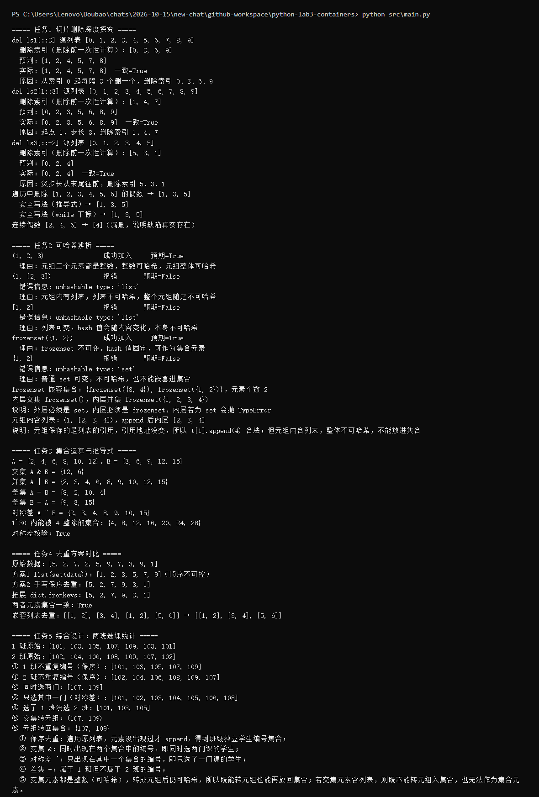
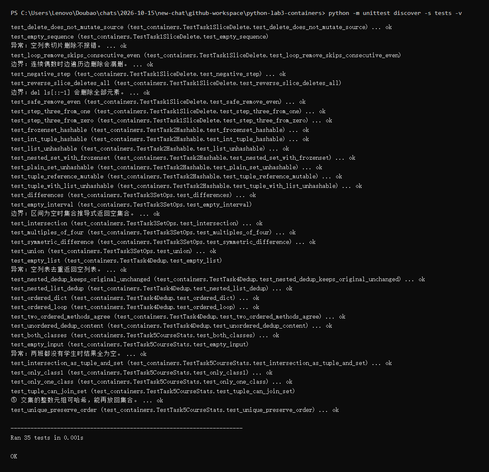

# 实验报告：Python 列表、元组、集合

- **课程**：Python 程序设计
- **实验学时**：2 学时
- **实验类型**：验证＋综合设计＋分析探究型
- **实验环境**：Python 3.14.5、VS Code、无第三方库依赖
- **实验日期**：2026-11-05

---

## 一、实验目的

1. 掌握列表、元组、集合的底层特性：可变与不可变、可哈希判定规则，区分"引用不可变"和"元素内容不可变"；
2. 掌握切片语法、步长正负、`del` 切片删除的执行逻辑，理解切片删除时"索引一次性计算"的陷阱；
3. 熟练运用集合的交、并、差、对称差运算，掌握集合推导式与列表推导式；
4. 能处理嵌套列表、嵌套元组，准确判断嵌套对象是否可哈希；
5. 理解 `set` 去重丢失顺序的问题，实现保留原始顺序的去重算法；
6. 具备代码排错能力，能独立分析 `TypeError: unhashable type` 与切片删除预期不符等问题；
7. 根据需求自主选择容器，完成小型综合数据处理任务。

---

## 二、实验原理

| 容器 | 有序性 | 可变性 | 是否可哈希 | 底层结构 | 典型用途 |
|---|---|---|---|---|---|
| `list` | 有序 | 可变 | 不可哈希 | 动态数组，存对象引用 | 有序序列、频繁增删尾部 |
| `tuple` | 有序 | 不可变（引用地址不变） | 元素全部可哈希时才可哈希 | 定长数组 | 固定结构的数据、字典键、集合元素 |
| `set` | 无序 | 可变 | 不可哈希 | 哈希表 | 去重、成员判断、集合运算 |
| `frozenset` | 无序 | 不可变 | 可哈希 | 哈希表（只读） | 集合元素、字典键、嵌套集合 |

**关键结论**

1. `del 列表[切片]` 的删除索引是在**删除前按原始列表一次性算好**的，删除过程中列表缩短，但索引集合不会重新计算。
2. 元组的"不可变"指内部保存的**引用地址**不可改；引用指向的可变对象（如列表）内部仍可修改。
3. 可哈希的前提是对象的 `hash()` 在生命周期内保持固定，因此任何"内容可改"的对象（`list`、`set`、`dict`）都不可哈希。
4. 元组只要含任意一个不可哈希元素，整体就不可哈希：`(1, 2)` 可哈希，`(1, [2, 3])` 不可哈希。

---

## 三、实验步骤

1. **任务1**：先手写三条切片删除的预判结果，再运行核对，最后分析循环删除缺陷；
2. **任务2**：逐条把五种对象放进集合，记录成功或报错并说明理由；
3. **任务3**：对 `A = {2,4,6,8,10,12}`、`B = {3,6,9,12,15}` 完成五种集合运算，并用集合推导式生成 1~30 内 4 的倍数；
4. **任务4**：对 `data = [5,2,7,2,5,9,7,3,9,1]` 对比无序去重与两种保序去重，并完成嵌套列表去重；
5. **任务5**：完成两班选课编号的综合统计（保序去重、交集、对称差、差集、交集转元组）。

代码按任务拆成五个模块，另加 `main.py` 统一输出，`tests/` 用标准库 `unittest` 覆盖全部任务。

---

## 四、源代码

### 4.1 任务1 切片删除 `src/task1_slice_delete.py`

```python
def removed_indices(length: int, sl: slice) -> List[int]:
    """按切片在原始序列上一次性算出将删除的索引。"""
    return list(range(*sl.indices(length)))


def delete_by_slice(seq: Sequence, sl: slice) -> List:
    """返回删除切片元素后的新列表，不修改传入的序列。"""
    removed = set(removed_indices(len(seq), sl))
    return [item for index, item in enumerate(seq) if index not in removed]


def remove_even_while_iterating(seq: Sequence) -> List[int]:
    """复现「边 for 遍历边 remove」的缺陷写法，用于对比分析。"""
    data = list(seq)
    for item in data:
        if item % 2 == 0:
            data.remove(item)
    return data


def remove_even_safely(seq: Sequence) -> List[int]:
    """安全写法一：列表推导式生成新列表。"""
    return [item for item in seq if item % 2 != 0]


def remove_even_with_while(seq: Sequence) -> List[int]:
    """安全写法二：显式下标 + while，删除后不移动下标。"""
    data = list(seq)
    index = 0
    while index < len(data):
        if data[index] % 2 == 0:
            del data[index]
        else:
            index += 1
    return data
```

`slice.indices(n)` 会把 `start/stop/step` 规范化为可套进 `range` 的三元组，负步长、省略端点都由它处理，因此得到的就是删除前的原始索引。

### 4.2 任务2 可哈希探测 `src/task2_hash.py`

```python
def probe_hashable(obj) -> dict:
    """把对象尝试放进 set，返回是否成功以及失败原因。"""
    container = set()
    try:
        container.add(obj)
        return {"ok": True, "error": None, "container": container}
    except TypeError as exc:
        return {"ok": False, "error": str(exc), "container": container}


def nested_set_demo() -> dict:
    """用 frozenset 实现「集合里放集合」。"""
    a = frozenset({1, 2})
    b = frozenset({3, 4})
    nested = {a, b}
    return {"nested": nested, "size": len(nested), "intersection": a & b, "union": a | b}
```

### 4.3 任务3 集合运算 `src/task3_set_ops.py`

```python
A = {2, 4, 6, 8, 10, 12}
B = {3, 6, 9, 12, 15}


def set_operations(a: set, b: set) -> dict:
    return {
        "intersection": a & b,
        "union": a | b,
        "a_minus_b": a - b,
        "b_minus_a": b - a,
        "symmetric_difference": a ^ b,
    }


def multiples_of_four(start: int = 1, end: int = 30) -> set:
    return {x for x in range(start, end + 1) if x % 4 == 0}
```

### 4.4 任务4 去重 `src/task4_dedup.py`

```python
def dedup_unordered(data: List) -> List:
    """方案1：list(set(data))，最简洁，但丢失原始顺序。"""
    return list(set(data))


def dedup_ordered_loop(data: List) -> List:
    """方案2：遍历 + 成员判断，保留第一次出现顺序。"""
    result = []
    for item in data:
        if item not in result:
            result.append(item)
    return result


def dedup_ordered_dict(data: List) -> List:
    """拓展：dict.fromkeys 一行实现保序去重。"""
    return list(dict.fromkeys(data))


def dedup_nested(nest: List[List]) -> List[List]:
    """嵌套列表去重：先转元组判重，最后按需转回列表。"""
    seen = set()
    result = []
    for inner in nest:
        key = tuple(inner)
        if key in seen:
            continue
        seen.add(key)
        result.append(list(key))
    return result
```

### 4.5 任务5 综合统计 `src/task5_course_stats.py`

```python
def course_stats(class1: List[int], class2: List[int]) -> dict:
    unique1 = dedup_ordered_loop(class1)
    unique2 = dedup_ordered_loop(class2)

    set1 = set(class1)
    set2 = set(class2)
    both = set1 & set2                 # ② 同时选两门
    only_one = set1 ^ set2             # ③ 只选其中一门
    only_class1 = set1 - set2          # ④ 选 1 班没选 2 班

    both_tuple = tuple(sorted(both))   # ⑤ 交集转元组

    return {
        "class1_unique": unique1,
        "class2_unique": unique2,
        "both": sorted(both),
        "only_one": sorted(only_one),
        "only_class1": sorted(only_class1),
        "both_tuple": both_tuple,
    }
```

---

## 五、运行结果

运行 `python src/main.py`，完整输出见 `docs/images/run_output.txt`，整段输出的图片见 `docs/images/run_output.png`（图片内容为命令真实执行后的原文输出，按行原样渲染）。



关键片段：

```
===== 任务1 切片删除深度探究 =====
del ls1[::3] 源列表 [0, 1, 2, 3, 4, 5, 6, 7, 8, 9]
  删除索引（删除前一次性计算）：[0, 3, 6, 9]
  预判：[1, 2, 4, 5, 7, 8]
  实际：[1, 2, 4, 5, 7, 8]  一致=True
del ls2[1::3] 源列表 [0, 1, 2, 3, 4, 5, 6, 7, 8, 9]
  删除索引（删除前一次性计算）：[1, 4, 7]
  预判：[0, 2, 3, 5, 6, 8, 9]
  实际：[0, 2, 3, 5, 6, 8, 9]  一致=True
del ls3[::-2] 源列表 [0, 1, 2, 3, 4, 5]
  删除索引（删除前一次性计算）：[5, 3, 1]
  预判：[0, 2, 4]
  实际：[0, 2, 4]  一致=True
遍历中删除 [1, 2, 3, 4, 5, 6] 的偶数 → [1, 3, 5]
连续偶数 [2, 4, 6] → [4]（漏删，说明缺陷真实存在）
```

```
===== 任务3 集合运算与推导式 =====
交集 A & B = {12, 6}
并集 A | B = {2, 3, 4, 6, 8, 9, 10, 12, 15}
差集 A - B = {8, 2, 10, 4}
差集 B - A = {9, 3, 15}
对称差 A ^ B = {2, 3, 4, 8, 9, 10, 15}
1~30 内能被 4 整除的集合：{4, 8, 12, 16, 20, 24, 28}
```

```
===== 任务4 去重方案对比 =====
原始数据：[5, 2, 7, 2, 5, 9, 7, 3, 9, 1]
方案1 list(set(data))：[1, 2, 3, 5, 7, 9]（顺序不可控）
方案2 手写保序去重：[5, 2, 7, 9, 3, 1]
拓展 dict.fromkeys：[5, 2, 7, 9, 3, 1]
嵌套列表去重：[[1, 2], [3, 4], [1, 2], [5, 6]] → [[1, 2], [3, 4], [5, 6]]
```

```
===== 任务5 综合设计：两班选课统计 =====
① 1 班不重复编号（保序）：[101, 103, 105, 107, 109]
① 2 班不重复编号（保序）：[102, 104, 106, 108, 109, 107]
② 同时选两门：[107, 109]
③ 只选其中一门（对称差）：[101, 102, 103, 104, 105, 106, 108]
④ 选了 1 班没选 2 班：[101, 103, 105]
⑤ 交集转元组：(107, 109)
⑤ 元组转回集合：{107, 109}
```

单元测试：

```
$ python -m unittest discover -s tests -v
Ran 35 tests in 0.001s
OK
```

35 个用例覆盖五个任务的正常路径、边界与异常，完整记录见 `docs/images/unittest_output.txt`，同样的原文输出图片见 `docs/images/unittest_output.png`。



---

## 六、预判与结果对比分析

### 6.1 三组切片删除

| 语句 | 源列表 | 删除前算出的索引 | 预判 | 实际 | 是否一致 |
|---|---|---|---|---|---|
| `del ls1[::3]` | `[0..9]` | 0、3、6、9 | `[1,2,4,5,7,8]` | `[1,2,4,5,7,8]` | 一致 |
| `del ls2[1::3]` | `[0..9]` | 1、4、7 | `[0,2,3,5,6,8,9]` | `[0,2,3,5,6,8,9]` | 一致 |
| `del ls3[::-2]` | `[0..5]` | 5、3、1 | `[0,2,4]` | `[0,2,4]` | 一致 |

**关键理解**：三组都符合"按删除前的原始索引一次性计算"。最容易误判的是负步长：`ls3[::-2]` 会**先从末尾取索引 5，再往前跳到 3、1**，而不是从头部算。若按删除过程中动态索引理解，删掉 5 之后列表只剩 5 个元素，索引会整体偏移，得到的将是另一个结果——这正是"一次性计算"与"动态实时计算"的差别。

### 6.2 边遍历边删除的缺陷（重点）

```
ls4 = [1,2,3,4,5,6]
for i in ls4:
    if i % 2 == 0:
        ls4.remove(i)
```

- **预判**：偶数 2、4、6 全部删掉，剩下 `[1,3,5]`；
- **实际**：`[1,3,5]`——本题数据**恰好删干净了**，但这是巧合，不能说明写法正确。

**为什么本次"看起来对"**：`for` 循环内部维护一个递增的下标。删除 2 后，`3` 左移到索引 1，下一个下标 2 指向 `4`（刚好也是偶数，被删）；删除 4 后下标 3 指向 `6`，仍被删。因为**相邻元素恰好都不是要被删的元素**，跳过的位置都被后面的偶数补上了。

**把数据换成连续偶数即可暴露缺陷**：

```
[2,4,6] → [4]
```

删除 2 后 `4` 左移到索引 0，迭代下标已推进到 1，直接跳到 `6`，`4` 被漏删。**结论**：边遍历边删除会漏删，是否暴露取决于数据分布，属于典型的"偶发正确、实则错误"的写法。

**安全改写（两种，均已测试通过）**

```python
# 写法一：列表推导式，遍历原序列、生成新列表
data = [x for x in data if x % 2 != 0]

# 写法二：显式下标 + while，删除后不移动下标
index = 0
while index < len(data):
    if data[index] % 2 == 0:
        del data[index]        # 删除后 index 不递增，重新检查同一下标
    else:
        index += 1
```

### 6.3 任务2 五种对象的实测结果

| 对象 | 结果 | 报错信息（Python 3.14 原文） | 理由 |
|---|---|---|---|
| `(1, 2, 3)` | 成功 | — | 三个元素都是整数，可哈希，整体可哈希 |
| `(1, [2, 3])` | 报错 | `cannot use 'tuple' as a set element (unhashable type: 'list')` | 元组内有列表，列表不可哈希，整体随之不可哈希 |
| `[1, 2]` | 报错 | `cannot use 'list' as a set element (unhashable type: 'list')` | 列表可变，hash 值随内容变化 |
| `frozenset({1, 2})` | 成功 | — | 不可变，hash 固定，可作为集合元素 |
| `{1, 2}` | 报错 | `cannot use 'set' as a set element (unhashable type: 'set')` | 普通 set 可变，不可哈希，不能嵌套 |

**"集合里放集合"的正确做法**：外层用 `set`，内层用 `frozenset`。

```python
nested = {frozenset({1, 2}), frozenset({3, 4})}   # 合法，元素个数 2
```

### 6.4 两种去重方案对比（任务4）

| 方案 | 代码 | 结果 | 优点 | 缺点 |
|---|---|---|---|---|
| 方案1 无序 | `list(set(data))` | `[1,2,3,5,7,9]` | 一行完成、哈希表去重 O(n) | **丢失原始顺序**；元素必须可哈希，嵌套 list 直接报错 |
| 方案2 手写保序 | 遍历 + `not in` 判断 | `[5,2,7,9,3,1]` | 保留首次出现顺序，逻辑直观 | `in` 每次线性扫描，最坏 O(n²) |
| 拓展 字典键 | `list(dict.fromkeys(data))` | `[5,2,7,9,3,1]` | 保序且 O(n)，最推荐 | 依赖 3.7+ 字典保序特性 |

方案1 的 `[1,2,3,5,7,9]` 是本次运行的具体顺序，**不同版本、不同数据类型下顺序可能变化**，因此不能依赖它；方案2 与拓展方案结果完全一致，符合"保留第一次出现顺序"的要求。

### 6.5 嵌套列表去重（拓展）

`nest = [[1,2],[3,4],[1,2],[5,6]]` 中内层 `list` 不可哈希，直接 `set(nest)` 会抛 `TypeError`。处理办法是**先转元组再判重，最后按需转回列表**：

```
[[1,2],[3,4],[1,2],[5,6]] → [[1,2],[3,4],[5,6]]
```

实现中用 `key = tuple(inner)` 判重，`result.append(list(key))` 返回新列表，原数据未被修改（已有用例断言）。

### 6.6 任务5 结果与口径核对

| 小问 | 计算方式 | 结果 | 说明 |
|---|---|---|---|
| ① 1 班保序去重 | 遍历判重 | `[101,103,105,107,109]` | 去掉了重复的 103、101 |
| ① 2 班保序去重 | 遍历判重 | `[102,104,106,108,109,107]` | 去掉了重复的 102 |
| ② 同时选两门 | `s1 & s2` | `[107,109]` | 两个班都出现过的编号 |
| ③ 只选一门 | `s1 ^ s2` | `[101,102,103,104,105,106,108]` | 只出现在其中一个集合 |
| ④ 只选 1 班 | `s1 - s2` | `[101,103,105]` | 属于 1 班且不属于 2 班 |
| ⑤ 交集转元组 | `tuple(sorted(both))` | `(107,109)` | 元素均为整数，元组可哈希 |
| ⑤ 元组转回集合 | `set(both_tuple)` | `{107,109}` | 可还原 |

**口径校验**：对称差满足 `s1 ^ s2 = (s1 - s2) | (s2 - s1)`，即

```
{101,103,105} | {102,104,106,108} = {101,102,103,104,105,106,108}  ✓
```

与 ③ 的实际结果完全一致；同时 ② 与 ③ 无交集、合并后等于两班全部去重编号 `{101..109}`，说明五个小问的口径互不冲突。

单元测试中已断言 ③ 的完整集合，数值与手算一致。

---

## 七、必答思考题

### 思考题1：`del ls[::3]` 是按删除前索引计算还是动态实时索引？举例说明

按**删除前的原始索引一次性计算**。

```python
ls = [0,1,2,3,4,5,6,7,8,9]
del ls[::3]        # 删除索引 0、3、6、9（删除前算好）
# 结果 [1,2,4,5,7,8]
```

若按动态索引，删掉 0 后列表变为 `[1..9]`，下一个"索引 3"会指向原来的 4，删除的元素集合将完全不同。实际结果证明删除集合在执行前就已固定。负步长同理：`[0,1,2,3,4,5]` 执行 `del ls[::-2]`，删除的是 5、3、1。

### 思考题2：`t = (1, [2, 3])`，为什么 `t[1].append(4)` 合法，但 `t` 不能放入集合？

元组的"不可变"约束的是**元组本身保存的引用地址**，不是引用所指向对象的内部状态。

```python
inner = [2, 3]
t = (1, inner)
t[1].append(4)     # 合法：修改的是列表内容，元组存的仍是同一个列表对象
print(t)           # (1, [2, 3, 4])
```

但可哈希要求对象整体 `hash()` 值在生命周期内不变。元组含 `list` 时，只要列表内容一变，元组"内容"就变，哈希无法保持稳定，因此 Python 判定其不可哈希，`set.add(t)` 抛 `TypeError`。

### 思考题3：为什么普通 set 不能嵌套，frozenset 可以作为集合元素？

`set` 可变：`add`、`remove` 都会改变其内部元素，哈希值随之变化。集合的元素必须可哈希（哈希表靠哈希值定位桶），所以 `set` 不能作为另一个集合的元素。

`frozenset` 创建后不可修改，哈希值固定，满足可哈希条件，因而能放进 `set`、也能作为 `dict` 的键。需要"集合里放集合"时，外层 `set`、内层 `frozenset`：

```python
{frozenset({1, 2}), frozenset({3, 4})}
```

### 思考题4：为什么 for 遍历列表同时 remove 会出现删不干净？给出安全方案

`for` 遍历列表时由内部下标驱动，每次取下一下标。删除当前元素后，后续元素整体左移一位，而迭代下标照常 +1，于是**紧跟被删元素的下一个元素被跳过**。若被跳过的恰好也是待删元素，就出现漏删。

```python
data = [2, 4, 6]
for i in data:
    if i % 2 == 0:
        data.remove(i)      # 删 2 后 4 左移到索引 0，迭代已到索引 1，4 被跳过
# 结果 [4]，漏删
```

安全方案（任选其一）：

```python
# 1) 列表推导式生成新列表
data = [x for x in data if x % 2 != 0]

# 2) while + 显式下标，删除后不移动下标
index = 0
while index < len(data):
    if data[index] % 2 == 0:
        del data[index]
    else:
        index += 1

# 3) 倒序遍历删除，删除不影响未遍历部分的下标
for index in range(len(data) - 1, -1, -1):
    if data[index] % 2 == 0:
        del data[index]

# 4) 遍历副本，删原列表
for item in data.copy():
    if item % 2 == 0:
        data.remove(item)
```

### 思考题5：`list(set(数据))` 去重的缺陷是什么？保序去重有哪些实现方式？

**缺陷**

1. **丢失原始顺序**：`set` 无序，输出顺序不可控，`[5,2,7,...]` 会变成 `[1,2,3,5,7,9]`；
2. **元素必须可哈希**：对嵌套列表这类不可哈希元素直接报 `TypeError`，必须先转换成元组；
3. 额外构建哈希表，内存开销高于原地判断（数据量大时才体现优势）。

**保序去重的实现方式**

```python
# 方式1：遍历 + 成员判断（最直观，O(n²) 最坏）
result = []
for item in data:
    if item not in result:
        result.append(item)

# 方式2：dict.fromkeys（3.7+ 字典保序，O(n)）
list(dict.fromkeys(data))

# 方式3：OrderedDict.fromkeys（兼容旧版本）
list(OrderedDict.fromkeys(data))
```

本次实测方式1 与方式2 结果均为 `[5, 2, 7, 9, 3, 1]`，一致。

---

## 八、实验小结

**三种容器的特性与选型**

- `list`：有序可变，适合需要按下标访问、频繁增删尾部、保留顺序的场景；切片会生成新对象，`del` 切片按删除前索引一次性删除。
- `tuple`：有序不可变（引用地址固定），适合表达固定结构、作为字典键或集合元素；但含可变元素时整体不可哈希。
- `set`：无序可变、元素必须可哈希，适合去重、成员判断与交并差运算；需要嵌套时用 `frozenset`。

**哈希约束**：可哈希 = 生命周期内 `hash()` 固定。`list`、`set`、`dict` 均不可哈希；`tuple`、`frozenset` 仅在元素全部可哈希时可哈希。

**易错点**

1. 误以为 `del 列表[切片]` 是动态索引，尤其是负步长；
2. 边遍历边 `remove`，在"相邻待删元素"时漏删，且数据不同表现不同，隐蔽性强；
3. 误认为 `tuple` 完全不可变，忽略其内部引用指向的对象仍可修改；
4. 用 `list(set(...))` 去重后误以为顺序可控；
5. 直接对嵌套列表调用 `set()`，触发 `unhashable type: 'list'`。

**方法论收获**：先手写预判再运行核对，比"跑通就算完成"更能暴露理解偏差；本次 `[1,2,3,4,5,6]` 的循环删除"看起来正确"，正是靠追加 `[2,4,6]` 对照实验才确认缺陷真实存在——**验证要主动构造能推翻自己的数据**。
